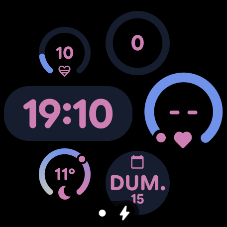
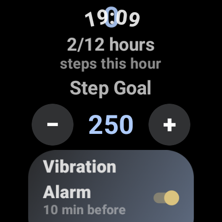
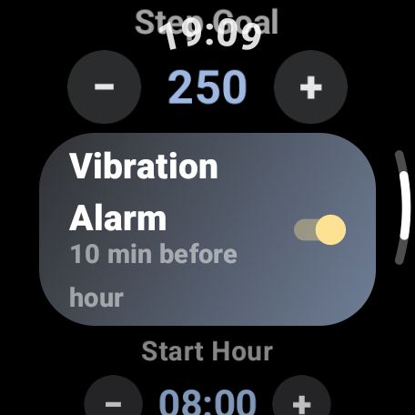
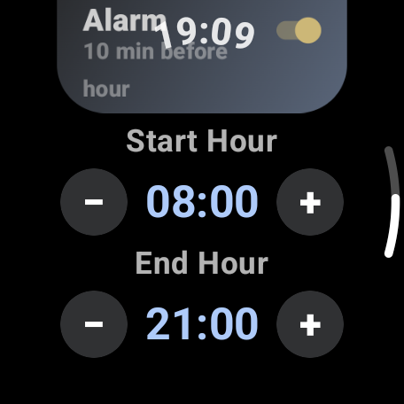

# MySteps

**Hourly step tracking with progress arc, vibration alerts, and configurable goals for Wear OS.**

## Screenshots

<p align="center">
  
  
  
  
</p>

## Why This App Exists

Google Fit and Google Health have **never provided hourly step count complications** despite years of user requests. MySteps fills this gap with a focused solution that tracks your steps per hour and keeps you moving throughout the day.

## Features

### Watch Face Complication
- **Progress arc** showing step completion toward your hourly goal
- **Heart icon** (❤) when goal is reached, with daily progress (e.g. `❤3/5` = 3 of 5 hours completed)
- **Real-time updates** as you walk while screen is on
- **Smart tap**: opens settings when goal reached, refreshes step count when not

### Vibration Alarm
- **Vibrates 10 minutes before the hour** if step goal not reached
- **"Move!" notification** clears when tapped, when you reach the goal, or when the hour ends
- **Auto-stops** when you reach the goal or the hour changes
- **Toggle on/off** in settings

### Configurable Settings
- **Step goal**: adjustable in 50-step increments (default: 250)
- **Active interval**: start and end hour for tracking (default: 08:00 - 21:00)
- **Vibration alarm**: on/off toggle

### Metro Watch Face (`metroface/`)
- Separate Watch Face Format (v4) watch face, built as its own resource-only APK
- Big time, date row, and four round badges (no labels): heart rate, Active Zone Minutes (complication slot, Fitbit by default), **MySteps** (complication with a progress ring), and temperature
- Optional seconds (Customize → Seconds)
- Screen-on brightness set from the MySteps app (Settings → **Metro Face**, 5–100%, default 30%); the face reads it through a hidden complication
- Low-power always-on mode (~2% lit pixels vs Google's 15% limit): pure black background, outlined time, badges as dark rings with dimmed numbers
- The XML is generated: edit `metroface/generate_watchface.py`, then run `python3 metroface/generate_watchface.py`
- Requires Wear OS 6 (API 36)

### MySteps Active Watch Face (`activeface/`)
- Watch Face Format (v4) face laid out like Google's "Active" face (positions, rings and colors measured on a Pixel Watch 3)
- Rings: top left (Active Zone Minutes by default), top **MySteps**, heart rate with a bpm marker; time pill; weather (big condition icon behind the temperature); date (day, then month)
- Why it exists: Google's face is handed to the low-power display chip, which lights it up on a wrist raise without waking Android, so complications show stale data until you tap. This face can't be offloaded (TimeText), so a wrist raise wakes the watch and MySteps refreshes immediately
- Customize → Colors: text / icon color pairs — pink & blue (default) plus a Fitbit Inspire 3 inspired set (Morning Glow, Lilac Bliss, Midnight Zen, Fitbit Teal, Zone Minutes); the heart-rate heart stays red
- Font: Google Sans Flex (OFL), rounded static instances; icons: Material Symbols (Apache 2.0). Rebuild them with `python3 activeface/tools/build_assets.py <GoogleSansFlex.ttf> <symbols-svg-dir>`
- The XML is generated: edit `activeface/generate_watchface.py`, then run `python3 activeface/generate_watchface.py`

### Hourly Progress Tracking
- Tracks how many hours you've met your step goal within your active interval
- Displayed on the complication (e.g. `❤3/5`) and in the app

## Requirements

- Wear OS 3.0+ (API 30)
- Step counter sensor

## Installation

```bash
./gradlew assembleDebug
adb install app/build/outputs/apk/debug/app-debug.apk

# Metro watch face (optional)
./gradlew :metroface:assembleDebug
adb install metroface/build/outputs/apk/debug/metroface-debug.apk

# MySteps Active watch face (optional)
./gradlew :activeface:assembleDebug
adb install activeface/build/outputs/apk/debug/activeface-debug.apk
```

## Usage

1. Long-press your watch face → Customize → select a complication slot
2. Choose **"Hourly Steps"**
3. Open MySteps app to configure step goal, alarm, and active hours

## Architecture

```
com.adrianp.mysteps/
├── complication/
│   ├── HourlyStepsComplicationService.kt   # RANGED_VALUE + SHORT_TEXT complication
│   ├── FaceBrightnessComplicationService.kt # Metro face brightness (hidden slot)
│   └── ComplicationTapReceiver.kt          # Smart tap handler
├── service/
│   ├── StepCounterService.kt              # Foreground service, sensor, alarm, screen tracking
│   ├── StepAlarmReceiver.kt               # Hourly :50 alarms + "Move!" notification
│   └── BootReceiver.kt                    # Reschedules alarms after reboot
└── presentation/
    ├── MainActivity.kt                    # Settings UI (Compose)
    └── theme/Theme.kt
```

## License

This project is currently unlicensed. Please contact the author for usage permissions.
